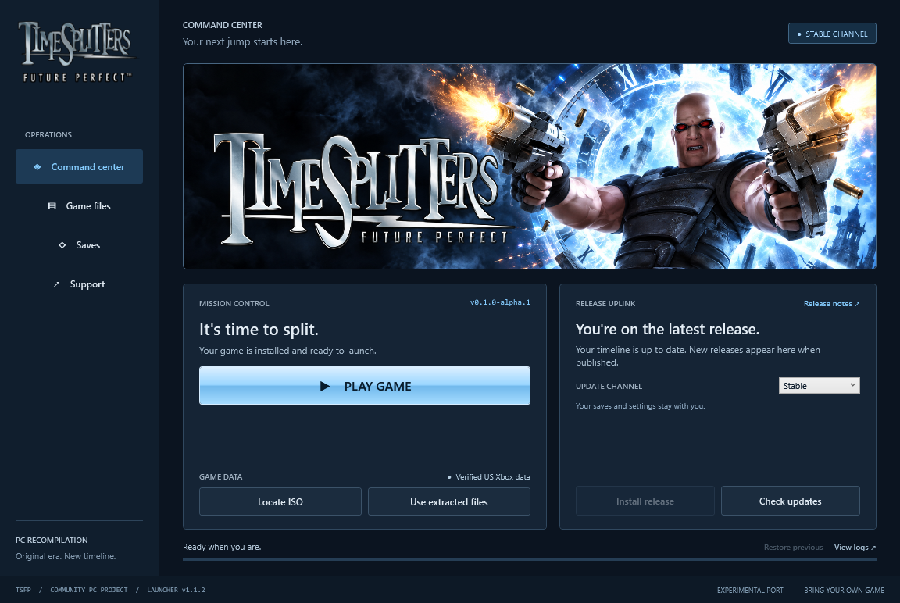

# TimeSplitters: Future Perfect

### The Xbox classic. A new home on PC.

Direct mouse aiming · 4K & ultrawide · Custom controls · Online & LAN

**[Quick start](#start-playing)** · [Launcher guide](docs/launcher.md) · [Multiplayer](docs/multiplayer.md) · [Build from source](docs/building.md)

Windows 10/11 x64 · Experimental PC port · Bring your own US Xbox game

Published launcher v1.1.2 interface preview. Version and channel shown are sample state; choose <strong>Preview</strong> to install current game prereleases.

> [!IMPORTANT]
> You need your own supported **US Xbox ISO or extracted game data**. Import it
> once through the launcher; afterward, play from the launcher without the ISO.
> Original game files are not included. No emulator or developer tools are needed.

## Start playing

| | Get ready for your next jump |
| :---: | --- |
| **01** | **Download the launcher.** Get `TimeSplitters-Launcher-v1.1.2-windows-x64.zip` from the [launcher release](https://github.com/TheDoffman/timesplitters-future-perfect-pc/releases/tag/launcher-v1.1.2). |
| **02** | **Extract and open.** Extract the whole ZIP to a writable folder, keeping `Bin` and `Support` together. Open **TimeSplitters Launcher.exe**. |
| **03** | **Install the game runtime.** Set **Update channel → Preview**, then choose **Install release**. The launcher downloads and verifies the published PC runtime. |
| **04** | **Import your game once.** Choose **Locate ISO**, or **Use extracted files** for a folder containing `default.xbe`, `pak` and `xmv`. |
| **05** | **Press Play Game.** The launcher minimizes when the game window appears and returns when you finish. |

**Next time:** open **TimeSplitters Launcher.exe → Play Game**. Installed play
remains available offline.

<strong>System requirements, channels and keeping your saves</strong>

- **Windows 10/11 x64** with **.NET Framework 4.8**.
- Your supported **US Xbox game**, title ID `45410066`; [exact executable hash](docs/building.md#inputs-and-generated-files).
- Internet access for the initial runtime download; about **5 GB** for the game,
  plus space for update staging, rollback and any optional textures.
- **Preview** includes published game prereleases. **Stable** excludes them.
  Launcher and game versions are separate.
- Keep the whole installation together, especially `Data`, `Settings`, `Saves`
  and the launcher's recovery files. Normal updates preserve existing data,
  settings and saves.

Python, Git and Visual Studio are not required to play.

## Built for PC play

<table>
<tr>
<td width="50%" valign="top"><strong>Precise mouse aiming</strong> Direct camera control, zoom-aware sensitivity and normalized WASD movement. Rebind actions and adjust sensitivity with <strong>F2</strong>.</td>
<td width="50%" valign="top"><strong>A bigger view</strong> Native <strong>1080p, 1440p and 4K</strong> rendering, monitor-reported ultrawide modes and adaptive in-engine cutscene framing.</td>
</tr>
<tr>
<td valign="top"><strong>Your controls, on screen</strong> Formatted menu and HUD prompts follow your bindings and switch back to controller icons when you use a controller.</td>
<td valign="top"><strong>Jump in with friends</strong> Experimental player-hosted Online matches, invitations, private join codes and compatible-build browsing, plus LAN System Link.</td>
</tr>
<tr>
<td valign="top"><strong>One place to launch and update</strong> Install releases, import game data, check updates and press <strong>Play Game</strong>. Roll back an update when a previous release is available.</td>
<td valign="top"><strong>See how it runs</strong> Optional FPS, frame-time and network-latency displays. Use <strong>F9</strong> for the FPS overlay and <strong>F12</strong> for debug settings.</td>
</tr>
</table>

Recent fixes improve pickup-range checks, controller sensitivity adjustment,
story audio transitions, Khallos Express scenery rendering and multiplayer
movement updates. [See measured progress →](STATUS.md)

### Make it yours

| Controls | Display | Launcher |
| --- | --- | --- |
| **F2** opens keyboard/mouse settings. Save bindings, sensitivity and inversion. Pause before editing. | **Settings → Display settings** (or paused **Options**) selects resolution. Confirm within **15 seconds** or it reverts. | **Check updates → Update release** installs game updates. **Saves**, **Game files**, **View logs** and **Support** keep essentials close. |

Click the game to capture the mouse; **Escape** pauses and releases it. Use
**Alt+Enter** for fullscreen. Settings saved in-game remain in place for your
next launcher session.

<strong>Default keyboard and mouse controls</strong>

| Action | Windows control |
| --- | --- |
| Move / look | W A S D / mouse |
| Fire / aim | Left / right mouse button |
| Use / confirm | E, Space or Enter |
| Reload / crouch | R / Ctrl or C |
| Melee / menu back | F, middle mouse or Backspace |
| Throw grenade | G or mouse button 5 |
| Change weapon | Mouse wheel or left/right arrows |
| Weapon mode / scope zoom in | Q or Up / Page Up |
| Change grenade / scope zoom out | V or Down / Page Down |
| Keyboard and mouse settings | F2 |
| Fullscreen | Alt+Enter |
| Show / hide the PC menu bar | F1 |
| FPS overlay / debug settings | F9 / F12 |

The original game has no jump action; Space is a confirm/action binding. Aim
and crouch behavior follows your in-game profile settings. F2 blocks gameplay
input but does not pause the simulation. Prompts baked into artwork retain their
original appearance. [Full controls and display guide →](docs/windows-settings.md)

## Play with friends

**Online / System Link → Online** opens the experimental competitive mode.
Host a match, share an invitation, or browse compatible public lobbies. No Steam
account, paid service or centrally operated server is required. Choose
**System Link** for LAN play.

> [!NOTE]
> Online hosts must forward **TCP 30820** and **UDP 30821** and allow them through
> the firewall. All players need matching builds and game data. Router setup is
> not automatic; real internet routing and sustained cross-machine play still
> need validation. Campaign co-op is a separate future effort.

**[Host or join a match →](docs/multiplayer.md)**

## In development

| Texture overhaul | Native Apple Silicon |
| --- | --- |
| Modern materials and surfaces, with **up to 4K** on major surfaces. A **6 GiB** active-pack budget and **512 MiB** replacement-residency limit keep storage and memory bounded. | A native **ARM64** build with SDL/Cocoa and OpenGL, shared PC controls, native settings and an experimental **up-to-120 FPS** presentation target. |
| **Partial local preview.** Much of the game still uses original art. Development artwork is not bundled with the public release; 4K output does not imply native 4K source detail. | **Experimental.** Visible first-level gameplay and basic combat checks have been reached. Interpolation keeps the game simulation at **60 Hz**; movies, advanced rendering, multiplayer and packaging still need work. |
| [Texture guide →](docs/textures.md) | [Mac setup →](docs/macos.md) · [Feature backlog →](MAC_PORT_BACKLOG.md) |

> [!NOTE]
> This is an experimental port. A full campaign playthrough and complete
> rendering fidelity remain unverified; periodic multiplayer frame-rate drops
> remain under investigation. Mac full-level completion and save/load are also
> unverified. Features describe current source and the published launcher—check
> **Release notes** for your installed game version.

## Guides & support

| Play & customize | Build & contribute |
| --- | --- |
| [Windows launcher](docs/launcher.md) — installation, updates and recovery | [Build guide](docs/building.md) — prerequisites, setup and patch workflow |
| [Controls & display](docs/windows-settings.md) — bindings, resolution and diagnostics | [Release publishing](docs/releasing.md) — package, validate and publish |
| [Multiplayer](docs/multiplayer.md) — Online, invitations and LAN | [Measured progress](STATUS.md) — evidence and remaining work |
| [Native Mac](docs/macos.md) — Apple Silicon setup and controls | [Project rules](AGENTS.md) — reproducibility and data preservation |

**Found a problem? [Report a bug](https://github.com/TheDoffman/timesplitters-future-perfect-pc/issues)**
with your game version/build ID, OS/GPU, level or mode, and reproduction steps.
Relevant logs or screenshots help; keep personal saves and game data private.

---

### Credits

Built on **[nemonicicon/ts3FPrecomp](https://github.com/nemonicicon/ts3FPrecomp)**,
with local runtime patches and platform adapters. This community project
statically recompiles the Xbox executable into native code; it does not recover
the original C/C++ source. [Pinned upstream and licensing →](docs/building.md#upstream-and-licensing)

This repository contains port code, patches and tooling. Original game assets,
the Xbox executable, generated game code, personal settings and saves remain
local. Retain the applicable upstream and third-party licenses with builds.
